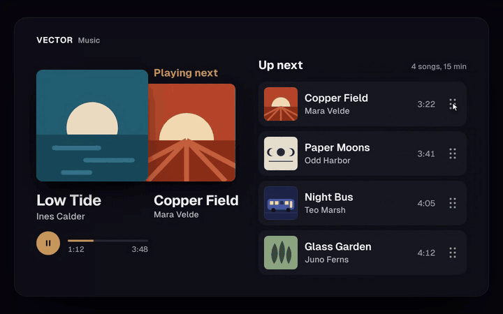

# Playlist Queue

**Drag a song to the top of the queue and its cover flies into the "Playing next" place.**



**Live demo:** [veraetogrex-portfolio.github.io/playlist-queue](https://veraetogrex-portfolio.github.io/playlist-queue/) · **Mockup:** [full-screen version](https://veraetogrex-portfolio.github.io/playlist-queue/mockup/playlist-queue.html)

A music player with its queue. Next to the current album there is a place for the next song, with that song's record standing in it. Pick a song up by its handle: the row lifts, the songs it passes step aside, and it settles into the gap. Whatever lands first in the queue becomes "Playing next": the old record slides back behind the album, the new cover lifts off its row, flies over and grows into the place, and the title under it changes as it lands.

## Use it

Three files, no build step, no dependencies, no web fonts:

```
index.html   markup
style.css    styles
script.js    data, drag and drop, animation
```

Download the repo and open `index.html`, or copy the three files into your project.

## Try it

- Drag any song by its handle (or anywhere on the row) up or down. Drop it first in the queue and its cover flies into "Playing next".
- Drop a song lower down: the queue reorders, and "Playing next" changes only if the first song changed.
- Keyboard: Tab to a handle, then ↑ ↓ move the song one place, Home sends it to the top, End to the bottom. Tab order follows the queue as shown.
- Click the play button to switch between pause and play.
- With reduced motion turned on, songs move without the lift and the cover appears in place.

## Make it yours

At the top of `script.js`:

- `NOW`: the album that is playing (`title`, `artist`, `art`).
- `SONGS`: the queue (`title`, `artist`, `time`, `art`). The "4 songs, 15 min" line is counted from it.
- `ART`: the album covers, drawn as small SVGs (one key per cover).
- `ROW` and `GAP`: row height and the space between rows, in px.

Colours live in `:root` in `style.css`: `--amber` for the play button, the held handle and "Playing next", `--row` and `--row-lift` for a song at rest and picked up, `--hole` for the gap a carried song will land in.

## What's in `mockup/`

The full 1440×900 screen this component was shot in for the reel:

- `mockup/playlist-queue.html` — interactive. `D` plays the demo, `R` resets.
- `mockup/playlist-queue.autoplay.html` — the scripted loop the reel was recorded from.
- URL flags: `?frame` puts the screen in a browser window, `?clean` hides the control panel, `?once` plays the demo once.

The mockup loads the same `style.css` and `script.js` from the root, plus a shared stage runtime and bundled fonts from `mockup/_shared/`. The component in the root doesn't need any of it.

---

Component 25 of a series. New one every day on Instagram [@veraetogrex_portfolio](https://www.instagram.com/veraetogrex_portfolio/) · all components: [github.com/veraetogrex-portfolio](https://github.com/veraetogrex-portfolio)

MIT licensed.
